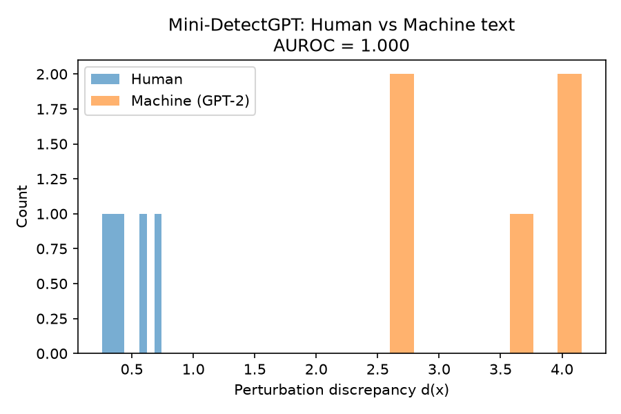

# Mini-DetectGPT: Detecting AI-Generated Text with Probability Curvature

A small, runnable reproduction of **DetectGPT** (Mitchell et al., ICML 2023), a zero-shot method that detects machine-generated text without training a classifier.



## The idea

Text written by a language model tends to sit near a **local peak** of that model's log-probability. If you make small changes that keep the meaning:

- **AI text:** the log-probability usually drops sharply.
- **Human text:** the log-probability changes much less.

So for each passage *x* we compute the **perturbation discrepancy**:

```
d(x) = log p(x) − mean( log p(x̃) )      where x̃ are T5-perturbed versions of x
```

A high `d(x)` suggests the text is machine-generated.

## How it works

1. Load a **source model** (GPT-2 small) and a **mask-filling model** (T5-small).
2. Generate machine passages from GPT-2 using prompts, alongside human-written passages.
3. Mask about 15% of the words in 2-word spans and let T5 refill them, giving `N_PERTURBATIONS` (default 20) rewrites per passage.
4. Score the original and each rewrite with GPT-2, then compute `d(x)`.
5. Report **AUROC** (0.5 = random, 1.0 = perfect) and save a histogram to `mini_detectgpt_results.png`.

## Quick start

```bash
pip install -r requirements.txt
python Mini_GPT.py
```

It runs on a laptop CPU (slowly) or a free Colab GPU (fast). To try larger models, change `SOURCE_MODEL_NAME` / `MASK_FILL_MODEL_NAME` at the top of `Mini_GPT.py` (for example `gpt2-medium`, `t5-base`).

## Roadmap (contributions welcome)

- [ ] Evaluate on a real dataset (for example human vs. LLM essays) instead of the 5 built-in samples
- [ ] Test against text from recent open LLMs (Llama, Mistral, Qwen) and against paraphrased text
- [ ] Add Fast-DetectGPT-style sampling for a big speed-up
- [ ] Chunk-based scoring for long documents
- [ ] Ensemble several scoring models
- [ ] CLI (`detect.py --file essay.txt`) and a Gradio demo on Hugging Face Spaces

## Reference

Eric Mitchell, Yoonho Lee, Alexander Khazatsky, Christopher D. Manning, Chelsea Finn. *DetectGPT: Zero-Shot Machine-Generated Text Detection using Probability Curvature.* ICML 2023. [arXiv:2301.11305](https://arxiv.org/abs/2301.11305)

## License

[MIT](LICENSE)
